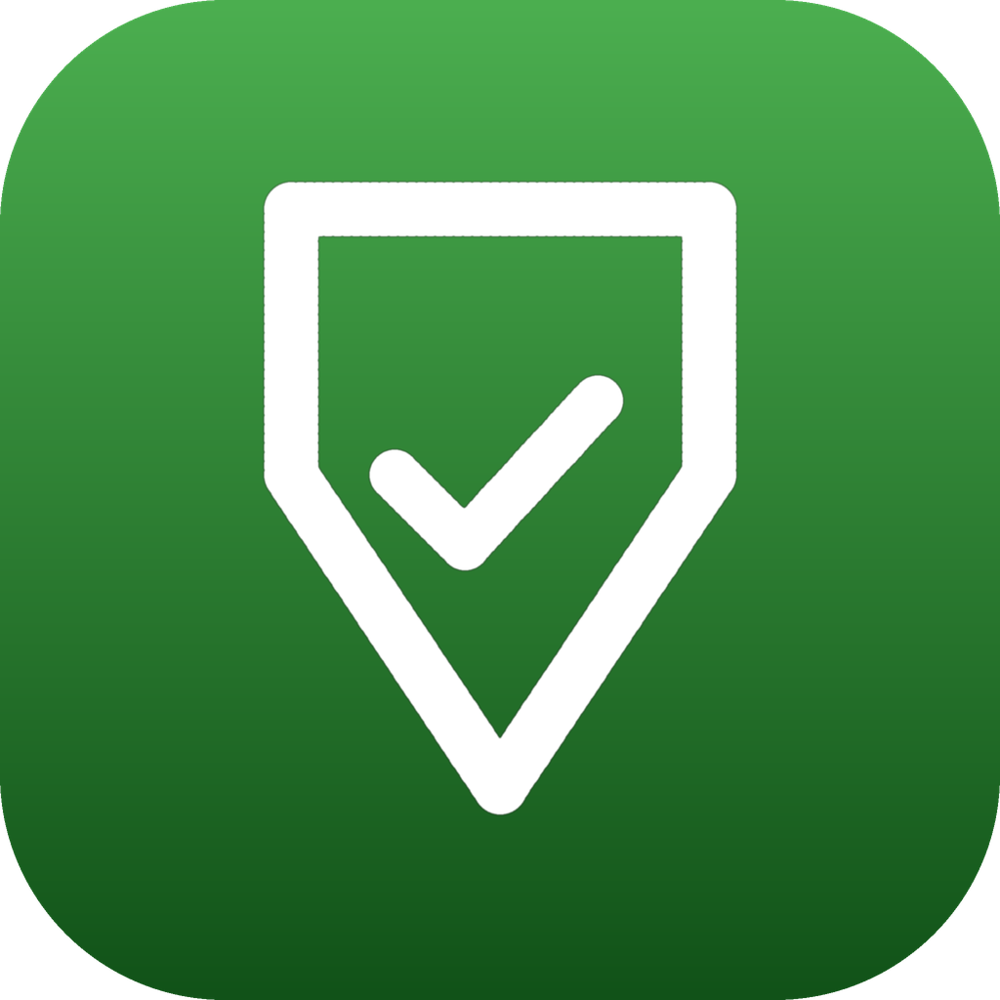
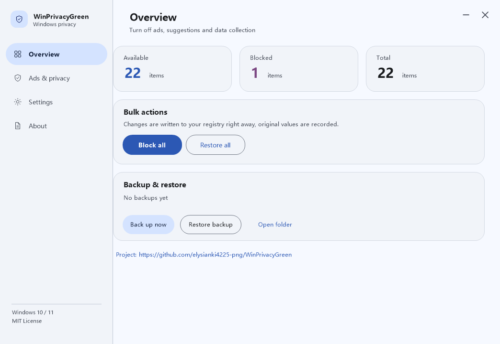
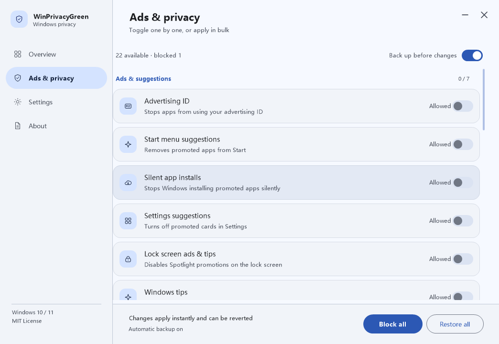
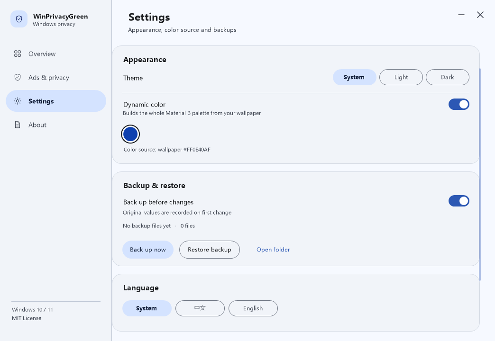
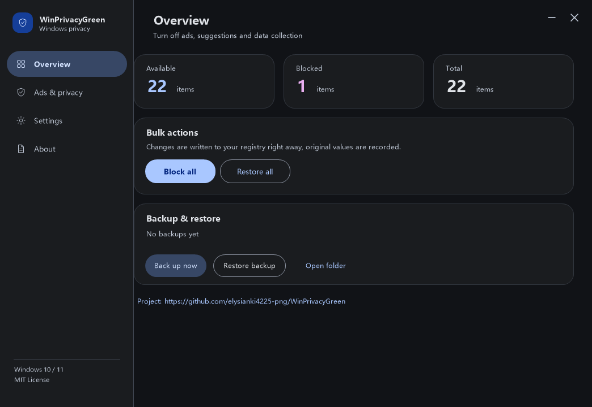
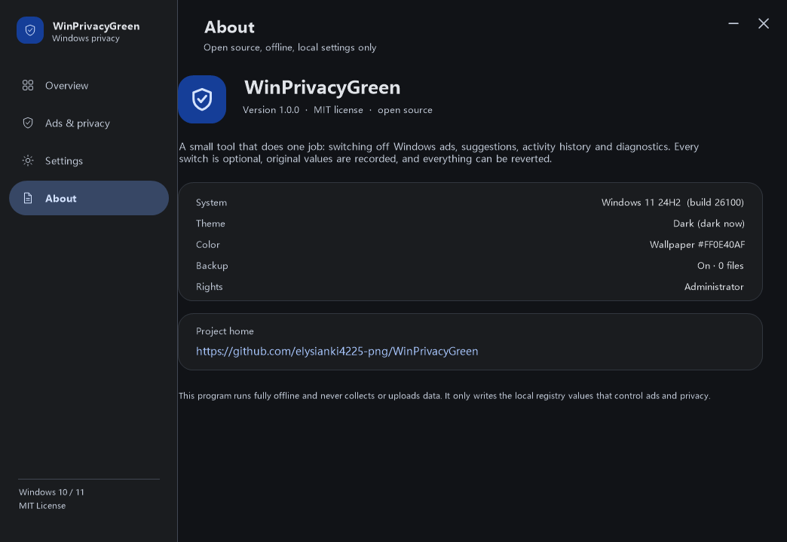

# WinPrivacyGreen

**一个只做一件事的绿色小工具：把 Windows 里的广告、推荐、活动记录和诊断数据关掉。**

原生 Win32 + GDI+ 编写，单文件 exe，免安装、不联网、不写系统服务。界面遵循 Material Design 3，支持亮色 / 暗色主题，并且可以从当前壁纸动态取色。

> 项目地址：<https://github.com/elysianki4225-png/WinPrivacyGreen>





| 广告与隐私 | 设置 |
| --- | --- |
|  |  |

| 暗色主题 | 关于 |
| --- | --- |
|  |  |

---

## 目录

- [功能](#功能)
- [动态取色与亮/暗主题](#动态取色与亮暗主题)
- [支持的系统](#支持的系统)
- [下载](#下载)
- [使用方法](#使用方法)
- [设置项清单](#设置项清单)
- [备份与恢复](#备份与恢复)
- [自行构建](#自行构建)
- [目录结构](#目录结构)
- [常见问题](#常见问题)
- [隐私声明](#隐私声明)
- [许可证](#许可证)

---

## 功能

- **广告与推荐**：关闭广告 ID、开始菜单推荐、推广应用自动安装、设置页推荐、锁屏推广、使用提示等。
- **搜索与开始菜单**：去掉搜索框里的网络结果、搜索亮点、任务栏资讯小组件、开始菜单“推荐的文件”。
- **活动与隐私**：活动历史记录、最近使用的文件、键入见解、定位、个性化诊断体验、反馈邀请。
- **诊断与反馈**：诊断数据级别、错误报告、CEIP、手写与输入样本、在线语音识别。
- **逐项开关**：每一项都可以单独打开或屏蔽，开关状态直接从注册表读取，不会出现“界面显示已关闭、实际没关”的情况。
- **一键批量**：`全部屏蔽` / `全部恢复`，同时保留逐项手动调整。
- **备份可选**：可以在界面上直接打开或关闭备份；开启时，每一项第一次被修改前都会记录原值。
- **零依赖**：单文件 exe，约 450 KB，不需要 .NET、不需要运行库、不写启动项。

## 动态取色与亮/暗主题

- **壁纸动态取色（Material You 风格）**：程序通过 `SystemParametersInfo(SPI_GETDESKWALLPAPER)` 找到当前的壁纸文件（也适用于 Windows 聚焦和幻灯片播放），把图像降采样后统计主色，再转换到 OKLCH 空间生成整套 Material Design 3 配色（primary / secondary / tertiary / surface 系列 / outline 等）。
- **随壁纸变化**：程序运行期间会定期检查壁纸是否变化，换壁纸后整套界面配色自动跟着变；不需要取色时，可以在「设置 → 动态取色」里直接关闭。
- **手动主色**：关闭动态取色后，可以从 5 个预设主色里选一个，界面配色会重新生成。
- **亮色 / 暗色 / 跟随系统**：三种模式可选，跟随系统时会响应 Windows 的亮暗切换；标题栏、滚动条、卡片、文字颜色都会按 Material 3 的角色色一起变化。
- **高 DPI**：Per-Monitor V2，多显示器不同缩放比例下界面不会发虚。
- **多语言**：界面内置简体中文与英文，可跟随系统语言，也可以在设置里手动切换（`跟随系统 / 简体中文 / English`）。

## 支持的系统

| 项目 | 说明 |
| --- | --- |
| Windows 10 | 1809 及以上（x64） |
| Windows 11 | 21H2 及以上（x64） |
| 系统语言 | 全部语言版本可用。注册表路径与语言无关，界面语言可自动/手动切换 |
| 权限 | 绝大多数项目标准用户即可修改；「诊断数据（可选）」等系统策略项需要管理员权限，界面中会以锁形图标标出 |
| 其他 | 免安装、绿色单文件；不需要 .NET / VC++ 运行库；不联网 |

> 说明：Windows 7/8.1 不在支持范围内（界面与取色依赖较新的系统接口）。
> 部分项目（例如任务栏资讯小组件、开始菜单推荐）在修改后需要重新登录或重启资源管理器才会看到效果。

## 下载

| 渠道 | 地址 |
| --- | --- |
| GitHub Releases | [最新版本](https://github.com/elysianki4225-png/WinPrivacyGreen/releases/latest) |
| 蓝奏云（备用） | <!-- TODO: 在这里粘贴蓝奏云分享链接 --> |
| 蓝奏云提取码 | <!-- TODO: 在这里填写提取码 --> |

下载 `WinPrivacyGreen.exe` 后直接双击运行即可，不需要安装。首次运行会在 `%APPDATA%\WinPrivacyGreen` 下创建配置与备份目录。

## 使用方法

1. 双击 `WinPrivacyGreen.exe`。
2. 左侧选择「广告与隐私」，逐项查看状态，点击右侧开关即可屏蔽或恢复；也可以直接点右下角 `全部屏蔽`。
3. 修改前如果开启了备份，程序会先把原值写入 `%APPDATA%\WinPrivacyGreen\backups`。
4. 想撤销时点 `全部恢复`（写回记录下来的原值），或在「设置 → 恢复最近备份」里选择一个时间点的备份。

关于备份开关：

- **开启（默认）**：每次修改某项前，记录该项的原始注册表值；`全部恢复` 会精确写回原值。
- **关闭**：修改时不再记录任何内容；此时 `全部恢复` 只能把各项写回 Windows 默认值，界面上会明确提示这一点。

## 设置项清单

共 21 项，分为四组。表内「需管理员」表示该项写入 `HKLM`，需要以管理员身份运行。

### 广告与推荐

| 项目 | 作用 | 备注 |
| --- | --- | --- |
| 广告 ID | 阻止应用使用广告 ID 推送个性化广告 | |
| 开始菜单推荐 | 隐藏开始菜单里的应用推广条目 | |
| 自动安装推广应用 | 阻止系统在后台静默装好推荐应用 | 需重新登录 |
| 设置页建议 | 关闭设置应用中的推荐卡片 | |
| 锁屏广告与提示 | 关闭锁屏上的 Windows 聚焦推广信息 | |
| Windows 使用提示 | 不再弹出功能介绍与使用建议 | |
| 完成设备设置提醒 | 关闭“继续设置你的设备”之类提示 | |

### 搜索与开始菜单

| 项目 | 作用 | 备注 |
| --- | --- | --- |
| 搜索框网络结果 | 搜索框只显示本机内容，不请求网页建议 | 需重启资源管理器 |
| 搜索亮点 | 去掉搜索面板里的节日与资讯插画 | |
| 任务栏资讯小组件 | 关闭任务栏天气与资讯入口 | 仅 Windows 11 |
| 开始菜单推荐文件 | 隐藏开始菜单“推荐”区域的文件建议 | 仅 Windows 11 22H2+ |

### 活动与隐私

| 项目 | 作用 | 备注 |
| --- | --- | --- |
| 活动历史记录 | 不记录、也不上传设备活动 | |
| 最近使用的文件 | 不在开始菜单记录最近打开的文件 | |
| 键入见解 | 停止收集输入统计信息 | |
| 定位服务 | 拒绝应用获取位置 | 关闭后地图等功能受影响 |
| 个性化诊断体验 | 不让微软用诊断数据定制提示与广告 | |
| 反馈请求频率 | 不再定期弹出 Windows 反馈邀请 | |

### 诊断与反馈

| 项目 | 作用 | 备注 |
| --- | --- | --- |
| 诊断数据（可选） | 把诊断数据限制在最低级别 | 需管理员 |
| 错误报告 | 崩溃后不向微软发送报告 | |
| 客户体验改善计划 | 退出 CEIP 数据收集 | |
| 手写与输入数据 | 不上传手写与输入样本 | |
| 在线语音识别 | 不把语音样本发送到微软 | |

具体注册表路径见 [`src/items.cpp`](src/items.cpp)，每一项都是一个可读的定义（键、值名、屏蔽值、恢复值），要新增项目只需在清单里加一条。

## 备份与恢复

程序采用两层保护，都放在 `%APPDATA%\WinPrivacyGreen\backups`：

- `originals.json`：记录每一项**第一次被修改前**的原值，`全部恢复` 会按它精确写回；恢复成功后该文件会被清空。
- `snapshot-YYYYMMDD-HHMMSS.json`：手动或批量操作前的完整快照，最多保留最近 20 份，可在「设置 → 恢复最近备份」中回滚。

备份内容只有注册表项的原值（键路径、值名、类型、数据），不包含任何个人信息。

## 自行构建

仓库提供的是可复现的交叉编译脚本，使用 [Zig](https://ziglang.org/) 自带的 Clang 与 MinGW 目标，在 Linux / macOS 上即可产出 Windows x64 可执行文件：

```bash
# 需要 zig 0.14 或更新版本
ZIG=/path/to/zig ./build/build.sh
# 产物：build/WinPrivacyGreen.exe
```

可选：重新生成图标（需要 Python 3 + Pillow）

```bash
python3 tools/make_icon.py
```

本机没有安装依赖时，也可以直接用 GitHub Actions（`.github/workflows/build.yml`）构建。

## 目录结构

```
src/
  main.cpp        程序入口（DPI 感知、COM、消息循环）
  ui.cpp          窗口、无边框标题栏、命中测试、动作分发
  ui_views.cpp    四个页面（概览 / 广告与隐私 / 设置 / 关于）的布局与绘制
  ui_draw.cpp     Material 3 基础控件：圆角卡片、按钮、开关、Chip、图标
  color.(h/cpp)   OKLab/OKLCH、色板生成、亮暗两套 Material 3 配色
  items.(h/cpp)   设置项清单（注册表键、值、屏蔽/恢复取值）
  backup.(h/cpp)  原值记录、快照、恢复
  sys.(h/cpp)     注册表、路径、系统版本、壁纸取色等 Win32 封装
  json.(h/cpp)    配置与备份用的极简 JSON 读写
resources/        图标、版本信息、manifest（PerMonitorV2、Win10/11 兼容）
assets/           图标源文件（png / ico）
tools/            图标生成脚本
build/            构建脚本与产物
```

代码全部为 C++17，除 GDI+ / DWM / 注册表等系统接口外没有第三方依赖。

## 常见问题

**Q：为什么有的项目改了没反应？**
A：部分设置（任务栏小组件、开始菜单推荐等）由 `explorer.exe` 启动时读取，修改后需要重启资源管理器或重新登录才会看到变化。

**Q：提示需要管理员权限怎么办？**
A：右键 `WinPrivacyGreen.exe` →「以管理员身份运行」。标准用户运行时，需要 `HKLM` 的项目会失败并给出提示，其余项目仍然可以正常修改。

**Q：会不会改坏系统？**
A：程序只写入下表中这类普通注册表值（大多在 `HKCU` 下），不会删除文件、不会改服务、不会写启动项；所有修改都能通过备份或 `全部恢复` 撤销。

**Q：程序会联网吗？**
A：不会。唯一的网络行为是你点击项目地址时，由系统浏览器打开 GitHub 页面。

**Q：能在 Windows 7 上用吗？**
A：不支持，请使用 Windows 10 1809 或 Windows 11。

**Q：界面字体不是雅黑？**
A：程序优先使用 `Microsoft YaHei UI`，缺失时回退到 `Segoe UI`。

## 隐私声明

本程序完全离线运行，不包含任何统计、遥测或自动更新功能；不收集、不上传任何数据。它读写的只有本机 `HKEY_CURRENT_USER` / `HKEY_LOCAL_MACHINE` 下与广告、搜索、活动记录、诊断相关的注册表值，以及 `%APPDATA%\WinPrivacyGreen` 下的配置与备份文件。

## 许可证

[MIT](LICENSE)

---

<sub>WinPrivacyGreen — 项目地址 <https://github.com/elysianki4225-png/WinPrivacyGreen></sub>
